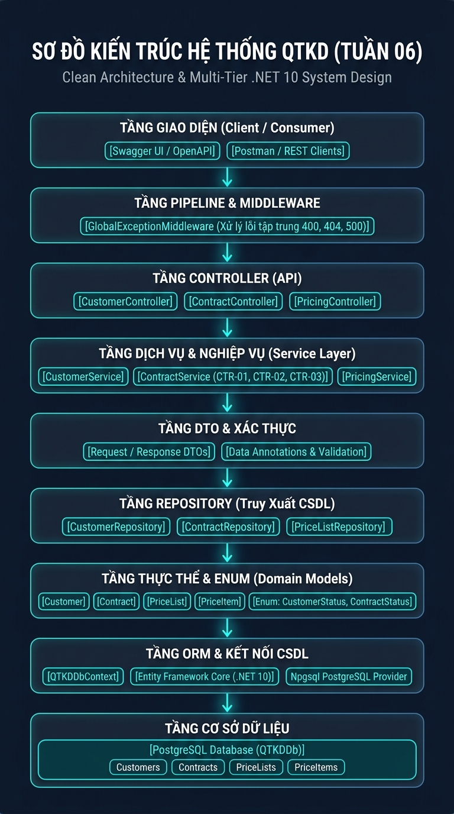

> **Sơ đồ trực quan:**  
> 

---

## MÔ TẢ TRÁCH NHIỆM TỪNG THÀNH PHẦN
| Tầng (Layer) | Thành phần chi tiết trong sơ đồ | Thư mục / Vị trí mã nguồn | Trách nhiệm chính |
| :--- | :--- | :--- | :--- |
| **1. TẦNG GIAO DIỆN** *(Client / Consumer)* | • `Swagger UI / OpenAPI` • `Postman / REST Clients` | Trình duyệt Web (`http://localhost:5174/swagger`) | Giao diện gửi các HTTP Request (`GET`, `POST`, `PUT`) để thao tác và kiểm thử toàn bộ luồng nghiệp vụ kinh doanh. |
| **2. TẦNG PIPELINE & MIDDLEWARE** | • `GlobalExceptionMiddleware` *(Xử lý lỗi tập trung 400, 404, 500)* | `src/QTKD.Api/Middleware/` `GlobalExceptionMiddleware.cs` | Đón bắt toàn bộ ngoại lệ chưa xử lý; tự động chuyển `InvalidOperationException` $\rightarrow$ **400 Bad Request** (cho các vi phạm CTR-01, CTR-02, CTR-03), `KeyNotFoundException` $\rightarrow$ **404 Not Found**, và **500** cho lỗi hệ thống; trả về JSON lỗi đồng nhất, loại bỏ hoàn toàn `try/catch` ở Controllers. |
| **3. TẦNG CONTROLLER (API)** | • `CustomerController` • `ContractController` • `PricingController` | `src/QTKD.Api/Controllers/` - `CustomerController.cs` - `ContractController.cs` - `PricingController.cs` | Cửa ngõ tiếp nhận HTTP Request; kiểm tra tính hợp lệ cơ bản của DTO (`ModelState.IsValid`); **tuyệt đối không gọi DbContext hay Repository** mà chỉ điều phối gọi tầng Service tương ứng; phản hồi mã HTTP Status chuẩn RESTful (`200 OK`, `201 Created`, `400 BadRequest`, `404 NotFound`). |
| **4. TẦNG DỊCH VỤ & NGHIỆP VỤ** *(Service Layer)* | • `CustomerService` • `ContractService` (CTR-01, 02, 03) • `PricingService` | `src/QTKD.Api/Services/` - `CustomerService.cs` - `ContractService.cs` - `PricingService.cs` | **Trọng tâm nghiệp vụ của hệ thống:** - Thực thi **CTR-01**: Chặn sửa hợp đồng khi ở trạng thái `PendingApproval`/`Approved`. - Thực thi **CTR-02**: Thẩm định điều kiện gửi duyệt (Customer Active, ngày hiệu lực hợp lệ, tệp đính kèm bắt buộc). - Thực thi **CTR-03**: Chỉ chuyển trạng thái sang `PendingApproval`, không chuyển thẳng sang `Approved`. - **Chống gửi lặp**: Chặn gửi duyệt nhiều lần đối với hợp đồng đang chờ duyệt. - Kiểm tra đơn giá dịch vụ $> 0$ và kiểm tra trùng mã khách hàng. |
| **5. TẦNG DTO & XÁC THỰC** | • `Request / Response DTOs` • `Data Annotations & Validation` | `src/QTKD.Api/DTOs/` - `CustomerDtos.cs` - `ContractDtos.cs` - `PricingDtos.cs` | Đóng gói dữ liệu trao đổi giữa Client và API (ngăn chặn rò rỉ hoặc mass-assignment thực thể CSDL); sử dụng Data Annotations (`[Required]`, `[Range]`, `[StringLength]`) để bắt lỗi sai định dạng ngay tại tầng API. |
| **6. TẦNG REPOSITORY** *(Truy Xuất CSDL)* | • `CustomerRepository` • `ContractRepository` • `PriceListRepository` | `src/QTKD.Api/Repositories/` - `CustomerRepository.cs` - `ContractRepository.cs` - `PriceListRepository.cs` | Độc quyền thao tác trực tiếp với `QtkdDbContext`; che giấu câu lệnh EF Core; thực hiện các thao tác CRUD bất đồng bộ (`async/await`); sử dụng Eager Loading (`.Include(c => c.Customer)`, `.Include(p => p.PriceItems)`) nạp dữ liệu quan hệ phục vụ kiểm tra nghiệp vụ. |
| **7. TẦNG THỰC THỂ & ENUM** *(Domain Models)* | • Thực thể: `Customer`, `Contract`, `PriceList`, `PriceItem` • Enums: `CustomerStatus`, `ContractStatus` | `src/QTKD.Api/Models/` - `Customer.cs`, `Contract.cs` - `PriceList.cs`, `PriceItem.cs` - `CustomerStatus.cs` - `ContractStatus.cs` | Định nghĩa mô hình thực thể CSDL và các kiểu liệt kê trạng thái an toàn: `CustomerStatus` (`Active = 1`, `Inactive = 0`) và `ContractStatus` (`Draft = 0`, `PendingApproval = 1`, `Approved = 2`, `Rejected = 3`, `RevisionRequested = 4`). |
| **8. TẦNG ORM & KẾT NỐI CSDL** | • `QTKDDbContext` • `Entity Framework Core (.NET 10)` • `Npgsql PostgreSQL Provider` | `src/QTKD.Api/Data/` - `QTKDDbContext.cs` - `Migrations/` | Quản lý kết nối PostgreSQL, cấu hình quan hệ khóa ngoại 1-N (Fluent API), chuyển đổi Enum thành String và nạp sẵn dữ liệu mẫu (Seed Data) chuẩn bị cho kịch bản chạy thử nghiệm xuyên suốt. |
| **9. TẦNG CƠ SỞ DỮ LIỆU** | • `PostgreSQL Database (QTKDDb)` • Các bảng: `Customers`, `Contracts`, `PriceLists`, `PriceItems` | `PostgreSQL Service` (Port 5432) | Hệ quản trị cơ sở dữ liệu quan hệ PostgreSQL lưu trữ bền vững toàn bộ dữ liệu thực tế tại database `QTKDDb`, đảm bảo tính toàn vẹn dữ liệu và ràng buộc khóa ngoại `CustomerId`, `PriceListId`. |
