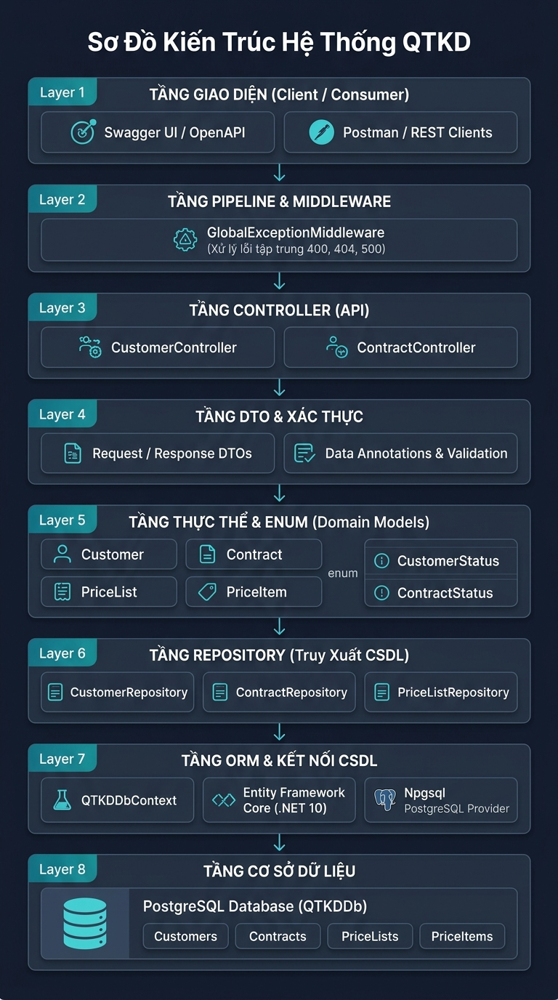

# KIẾN TRÚC VÀ TRÁCH NHIỆM CÁC THÀNH PHẦN (SOLUTION QTKD)

> **Sơ đồ trực quan:**  
> 

---

## MÔ TẢ TRÁCH NHIỆM TỪNG THÀNH PHẦN (KHỚP 8 LAYER THEO SƠ ĐỒ)

| Tầng (Layer) | Thành phần chi tiết trong sơ đồ | Thư mục / Vị trí mã nguồn | Trách nhiệm chính |
| :--- | :--- | :--- | :--- |
| **Layer 1: TẦNG GIAO DIỆN** *(Client / Consumer)* | • `Swagger UI / OpenAPI` • `Postman / REST Clients` | Công cụ ngoài / Trình duyệt Web (`http://localhost:5174/swagger`) | Giao diện tương tác và gửi các HTTP Request (`GET`, `POST`, `PUT`) để kiểm thử và khai thác các API của hệ thống. |
| **Layer 2: TẦNG PIPELINE & MIDDLEWARE** | • `GlobalExceptionMiddleware` *(Xử lý lỗi tập trung 400, 404, 500)* | `src/QTKD.Api/Middleware/` `GlobalExceptionMiddleware.cs` | Đón bắt toàn bộ ngoại lệ chưa xử lý trong pipeline; tự động chuẩn hóa mã phản hồi: **400 Bad Request** cho vi phạm quy tắc nghiệp vụ (CTR-01, CTR-02, CTR-03), **404 Not Found** cho dữ liệu không tồn tại và **500** cho lỗi hệ thống; trả về JSON đồng nhất. |
| **Layer 3: TẦNG CONTROLLER (API)** | • `CustomerController` • `ContractController` | `src/QTKD.Api/Controllers/` - `CustomerController.cs` - `ContractController.cs` | Điểm tiếp nhận request từ Client, kiểm tra tính hợp lệ cơ bản của dữ liệu (`ModelState.IsValid`), điều phối gọi tầng Repository / Service và phản hồi HTTP Status Code chuẩn RESTful (`200 OK`, `201 Created`, `400 BadRequest`, `404 NotFound`). |
| **Layer 4: TẦNG DTO & XÁC THỰC** | • `Request / Response DTOs` • `Data Annotations & Validation` | `src/QTKD.Api/DTOs/` - `CustomerDtos.cs` - `ContractDtos.cs` | Đóng gói dữ liệu trao đổi giữa Client và API (tách biệt hoàn toàn với thực thể DB); sử dụng Data Annotations (`[Required]`, `[MaxLength]`, v.v.) để tự động xác thực tính hợp lệ của dữ liệu đầu vào. |
| **Layer 5: TẦNG THỰC THỂ & ENUM** *(Domain Models)* | • Thực thể: `Customer`, `Contract`, `PriceList`, `PriceItem` • Enums: `CustomerStatus`, `ContractStatus` | `src/QTKD.Api/Models/` - `Customer.cs` - `Contract.cs` - `PriceList.cs` - `PriceItem.cs` - `CustomerStatus.cs` - `ContractStatus.cs` | Định nghĩa mô hình thực thể dữ liệu nghiệp vụ của hệ thống QTKD cùng các trạng thái an toàn kiểu dữ liệu (Enum): `CustomerStatus` (`Active = 1`, `Inactive = 0`) và `ContractStatus` (`Draft = 0`, `PendingApproval = 1`, `Approved = 2`, `Rejected = 3`). |
| **Layer 6: TẦNG REPOSITORY** *(Truy Xuất CSDL)* | • `CustomerRepository` • `ContractRepository` • `PriceListRepository` | `src/QTKD.Api/Repositories/` - `ICustomerRepository.cs` - `CustomerRepository.cs` - `IContractRepository.cs` - `ContractRepository.cs` - `IPriceListRepository.cs` - `PriceListRepository.cs` | Trừu tượng hóa việc truy xuất dữ liệu theo mẫu Repository Pattern; thực hiện các thao tác CRUD bất đồng bộ (`async/await`); sử dụng Eager Loading (`.Include(c => c.Customer)`, `.Include(p => p.Items)`) để nạp kèm dữ liệu quan hệ phục vụ kiểm tra quy tắc nghiệp vụ. |
| **Layer 7: TẦNG ORM & KẾT NỐI CSDL** | • `QTKDDbContext` • `Entity Framework Core (.NET 10)` • `Npgsql PostgreSQL Provider` | `src/QTKD.Api/Data/` - `QTKDDbContext.cs` - `Migrations/` - `Program.cs` | Cấu hình ánh xạ bảng, khóa chính, khóa ngoại 1-N (Fluent API), chuyển đổi Enum thành String trong database và nạp sẵn dữ liệu mẫu (Seed Data) chuẩn bị cho kịch bản chạy thử nghiệm xuyên suốt. |
| **Layer 8: TẦNG CƠ SỞ DỮ LIỆU** | • `PostgreSQL Database (QTKDDb)` • Các bảng: `Customers`, `Contracts`, `PriceLists`, `PriceItems` | `PostgreSQL Service` (Port 5432) | Hệ quản trị cơ sở dữ liệu quan hệ PostgreSQL lưu trữ bền vững toàn bộ dữ liệu thực tế tại database `QTKDDb`, đảm bảo tính toàn vẹn dữ liệu và ràng buộc khóa ngoại `CustomerId`, `PriceListId`. |
